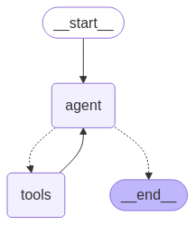
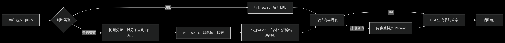
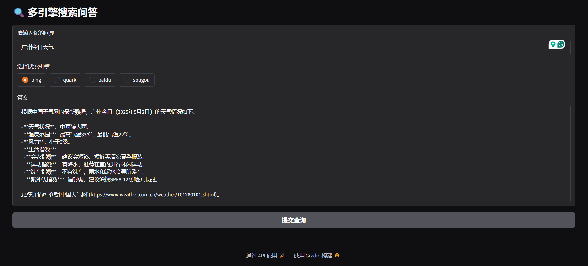
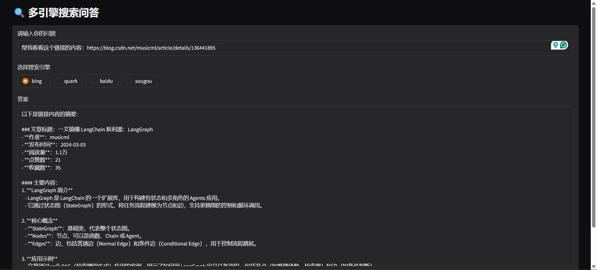

<div align="right">
  <details>
    <summary >🌐 Language</summary>
    <div>
      <div align="center">
        <a href="https://openaitx.github.io/view.html?user=itshyao&project=proxyless-llm-websearch&lang=en">English</a>
        | <a href="https://openaitx.github.io/view.html?user=itshyao&project=proxyless-llm-websearch&lang=zh-CN">简体中文</a>
        | <a href="https://openaitx.github.io/view.html?user=itshyao&project=proxyless-llm-websearch&lang=zh-TW">繁體中文</a>
        | <a href="https://openaitx.github.io/view.html?user=itshyao&project=proxyless-llm-websearch&lang=ja">日本語</a>
        | <a href="https://openaitx.github.io/view.html?user=itshyao&project=proxyless-llm-websearch&lang=ko">한국어</a>
        | <a href="https://openaitx.github.io/view.html?user=itshyao&project=proxyless-llm-websearch&lang=hi">हिन्दी</a>
        | <a href="https://openaitx.github.io/view.html?user=itshyao&project=proxyless-llm-websearch&lang=th">ไทย</a>
        | <a href="https://openaitx.github.io/view.html?user=itshyao&project=proxyless-llm-websearch&lang=fr">Français</a>
        | <a href="https://openaitx.github.io/view.html?user=itshyao&project=proxyless-llm-websearch&lang=de">Deutsch</a>
        | <a href="https://openaitx.github.io/view.html?user=itshyao&project=proxyless-llm-websearch&lang=es">Español</a>
        | <a href="https://openaitx.github.io/view.html?user=itshyao&project=proxyless-llm-websearch&lang=it">Italiano</a>
        | <a href="https://openaitx.github.io/view.html?user=itshyao&project=proxyless-llm-websearch&lang=ru">Русский</a>
        | <a href="https://openaitx.github.io/view.html?user=itshyao&project=proxyless-llm-websearch&lang=pt">Português</a>
        | <a href="https://openaitx.github.io/view.html?user=itshyao&project=proxyless-llm-websearch&lang=nl">Nederlands</a>
        | <a href="https://openaitx.github.io/view.html?user=itshyao&project=proxyless-llm-websearch&lang=pl">Polski</a>
        | <a href="https://openaitx.github.io/view.html?user=itshyao&project=proxyless-llm-websearch&lang=ar">العربية</a>
        | <a href="https://openaitx.github.io/view.html?user=itshyao&project=proxyless-llm-websearch&lang=fa">فارسی</a>
        | <a href="https://openaitx.github.io/view.html?user=itshyao&project=proxyless-llm-websearch&lang=tr">Türkçe</a>
        | <a href="https://openaitx.github.io/view.html?user=itshyao&project=proxyless-llm-websearch&lang=vi">Tiếng Việt</a>
        | <a href="https://openaitx.github.io/view.html?user=itshyao&project=proxyless-llm-websearch&lang=id">Bahasa Indonesia</a>
      </div>
    </div>
  </details>
</div>

# 🧠 无需代理的LLM网络搜索引擎

一个无需代理的多搜索引擎 LLM 网络检索工具，支持 URL 内容解析和网页爬取，结合 **LangGraph**与**LangGraph-MCP** 实现模块化智能体链路。专为大语言模型的外部知识调用场景而设计，支持 **Playwright + Crawl4AI** 网页获取与解析，支持异步并发、内容切片与重排过滤。

## 🚀 更新日志

- 🔥 2025-09-05：支持**langgraph-mcp**
- 🔥 2025-09-03：新增 Docker 部署、内置智能重排器、支持自定义文本切分器与重排器

## ✨ 特性一览

- 🌐 **无需代理**：通过 Playwright 配置国内浏览器支持，无需代理也能进行网络搜索。
- 🔍 **多搜索引擎支持**：支持 Bing、夸克、百度、搜狗 等主流搜索引擎，增强信息来源多样性。
- 🤖 **意图识别**：系统能够根据用户的输入内容，自动判断是进行网络搜索还是解析 URL。
- 🔄 **查询分解**：根据用户的搜索意图，自动将查询分解为多个子任务，并依次执行，从而提升搜索的相关性与效率。
- ⚙️ **智能体架构**：基于 **LangGraph** 封装的**「web_search」**与**「link_parser」**。
- 🏃‍♂️ **异步并发任务处理**：支持异步并发任务处理，可高效处理多个搜索任务。
- 📝 **内容处理优化**：

  - ✂️ **内容切片**：将网页长内容按段切分。

  - 🔄 **内容重排**：智能重排序，提高信息相关性。

  - 🚫 **内容过滤**：自动剔除无关或重复内容。
- 🌐 **多端支持**：
  - 🐳 **支持 Docker 部署**：一键启动，快速构建后端服务。

  - 🖥️ 提供 FastAPI 后端接口，可集成到任意系统中。

  - 🌍 提供 Gradio Web UI，可快速部署成可视化应用。

  - 🧩[ **浏览器插件支持**](https://github.com/itshyao/proxyless-llm-websearch/tree/main/extension)：支持 Edge ，提供智能 URL 解析插件，直接在浏览器中发起网页解析与内容提取请求。






## ⚡ 快速开始

### 克隆仓库

```bash
git clone https://github.com/itshyao/proxyless-llm-websearch.git
cd proxyless-llm-websearch
```

### 安装依赖

```
pip install -r requirements.txt
python -m playwright install
```

### 环境变量配置

```
# 百炼llm
OPENAI_BASE_URL=https://dashscope.aliyuncs.com/compatible-mode/v1
OPENAI_API_KEY=sk-xxx
MODEL_NAME=qwen-plus-latest

# 百炼embedding
EMBEDDING_BASE_URL=https://dashscope.aliyuncs.com/compatible-mode/v1
EMBEDDING_API_KEY=sk-xxx
EMBEDDING_MODEL_NAME=text-embedding-v4

# 百炼reranker
RERANK_BASE_URL=https://dashscope.aliyuncs.com/compatible-mode/v1
RERANK_API_KEY=sk-xxx
RERANK_MODEL=gte-rerank-v2
```

### Langgraph-Agent

#### DEMO

```shell
python agent/demo.py
```

#### API SERVE

```shell
python agent/api_serve.py
```

```python
import requests

url = "http://localhost:8800/search"

data = {
  "question": "广州今日天气",
  "engine": "bing",
  "split": {
    "chunk_size": 512,
    "chunk_overlap": 128
  },
  "rerank": {
    "top_k": 5
  }
}

try:
    response = requests.post(
        url,
        json=data
    )

    if response.status_code == 200:
        print("✅ 请求成功！")
        print("响应内容：", response.json())
    else:
        print(f"❌ 请求失败，状态码：{response.status_code}")
        print("错误信息：", response.text)

except requests.exceptions.RequestException as e:
    print(f"⚠️ 请求异常：{str(e)}")
```

#### Gradio

```
python agent/gradio_demo.py
```





#### docker

```
docker-compose -f docker-compose-ag.yml up -d --build
```

### Langgrph-MCP

#### 启动MCP服务

```
python mcp/websearch.py
```

#### DEMO

```
python mcp/demo.py
```

#### API SERVE

```
python mcp/api_serve.py
```

```
import requests

url = "http://localhost:8800/search"

data = {
  "question": "广州今日天气"
}

try:
    response = requests.post(
        url,
        json=data
    )

    if response.status_code == 200:
        print("✅ 请求成功！")
        print("响应内容：", response.json())
    else:
        print(f"❌ 请求失败，状态码：{response.status_code}")
        print("错误信息：", response.text)

except requests.exceptions.RequestException as e:
    print(f"⚠️ 请求异常：{str(e)}")
```

#### docker

```
docker-compose -f docker-compose-mcp.yml up -d --build
```

### 自定义模块

#### 自定义分块

```
from typing import Optional, List

class YourSplitter:
    def __init__(self, text: str, chunk_size: int = 512, chunk_overlap: int = 128):
        self.text = text
        self.chunk_size = chunk_size
        self.chunk_overlap = chunk_overlap

    def split_text(self, text: Optional[str] = None) -> List:
        # TODO: implement splitting logic
        return ["your chunk"]
```

#### 自定义重排

```
from typing import List, Union, Tuple

class YourReranker:
    async def get_reranked_documents(
        self,
        query: Union[str, List[str]],
        documents: List[str],
    ) -> Union[
        Tuple[List[str]],
        Tuple[List[int]],
    ]:
        return ["your chunk"], ["chunk index"]
```

## 🔍 与线上网络检索测试对比

我们将项目与一些主流的在线 API 进行对比，评估了其在复杂问题下的表现。

### 🔥 数据集

- 数据集来自阿里发布的 [WebWalkerQA](https://huggingface.co/datasets/callanwu/WebWalkerQA)，包含了 680 个高难度问题，覆盖教育、学术会议、游戏等多个领域。
- 数据集包括中英文问题。

### 🧑‍🏫 对比结果

| 搜索引擎/系统  | ✅ Correct | ❌ Incorrect | ⚠️ Partially Correct |
| -------------- | --------- | ----------- | ------------------- |
| **火山方舟**   | 5.00%     | 72.21%      | 22.79%              |
| **百炼**       | 9.85%     | 62.79%      | 27.35%              |
| **Our** | 19.85%    | 47.94%      | 32.06%              |
## 🙏 致谢

本项目部分功能得益于以下开源项目的支持与启发，特此致谢：

- 🧠 [LangGraph](https://github.com/langchain-ai/langgraph)：用于构建模块化智能体链路框架，帮助快速搭建复杂的智能体系统。
- 🕷 [Crawl4AI](https://github.com/unclecode/crawl4ai)：强大的网页内容解析工具，助力高效网页抓取与数据提取。
- 🌐 [Playwright](https://github.com/microsoft/playwright)：现代浏览器自动化工具，支持跨浏览器的网页抓取和测试自动化。
- 🔌 [Langchain MCP Adapters](https://github.com/langchain-ai/langchain-mcp-adapters)：用于多链处理MCP的构建。

